<div align="center">

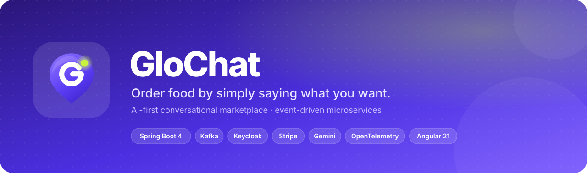

<br/><br/>

[](https://github.com/ISTIFANO/GloChat/actions/workflows/ci.yml)


**Tell GloChat what you feel like eating — *"un burger sous 70 dirhams"*, *"بغيت برغر"* —<br/>it finds the best options around you, and you order in a few taps.**

[Demo](#-demo) · [Features](#-features) · [Architecture](#-architecture) · [Flows](#-key-flows) · [Run it](#-run-it-locally) · [Tests](#-tests)

</div>

---

## 🎬 Demo

Real recordings of the app running against this backend (Keycloak, Kafka, PostgreSQL, Stripe test mode — no mocks).

<table>
  <tr>
    <th align="center">Welcome &amp; sign-in</th>
    <th align="center">Ask in plain words</th>
    <th align="center">Restaurants</th>
    <th align="center">Order</th>
  </tr>
  <tr>
    <td align="center"></td>
    <td align="center">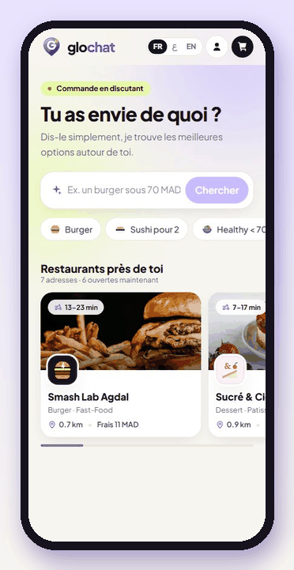</td>
    <td align="center"></td>
    <td align="center"></td>
  </tr>
  <tr>
    <td align="center"><sub>Sign in with Google or e-mail<br/>without leaving the shop</sub></td>
    <td align="center"><sub>Search understands budget and dish,<br/>options update the price live</sub></td>
    <td align="center"><sub>Open restaurants first, nearest first,<br/>merchant page with its menu</sub></td>
    <td align="center"><sub>Fly-to-cart, price-locked checkout,<br/>order confirmed and tracked</sub></td>
  </tr>
</table>

<details>
<summary><b>📱 More screens</b></summary>
<br/>
<table>
  <tr>
    <td align="center">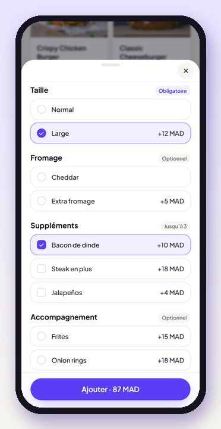<br/><sub>Product options</sub></td>
    <td align="center">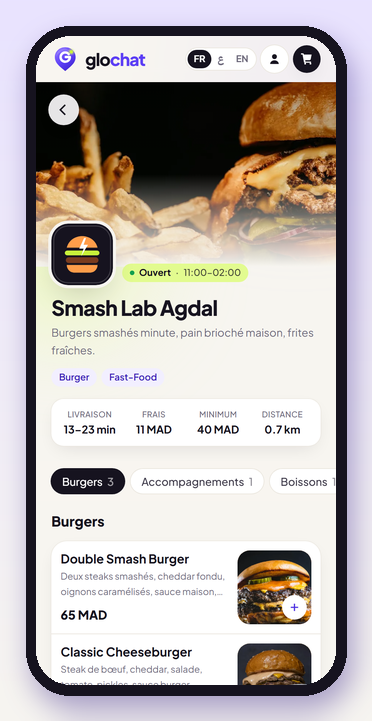<br/><sub>Merchant page</sub></td>
    <td align="center">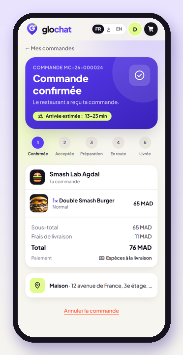<br/><sub>Order tracking</sub></td>
    <td align="center">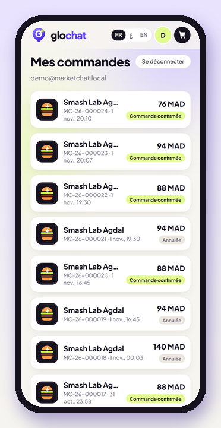<br/><sub>Order history</sub></td>
    <td align="center">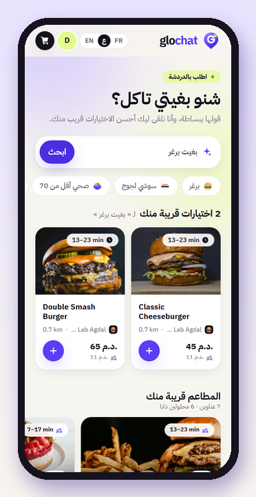<br/><sub>Arabic (RTL)</sub></td>
  </tr>
</table>
</details>

---

## ✨ Features

| | |
|---|---|
| 🔎 **Conversational search** | One search box across every restaurant: dish, budget (*"sous 50"*), French, Arabic or Darija, accents and typos tolerated (PostgreSQL trigram + normalisation). |
| 🛵 **Delivery-aware results** | Distance, delivery fee, ETA, minimum order and opening hours computed for the customer's location. |
| 🍔 **Configurable products** | Option groups (size, cheese, extras…) validated and priced on the server — the client never sets a price. |
| 🛒 **Cart** | One merchant per cart, identical lines merged, re-priced on every read, saved addresses, optimistic locking. |
| 🔒 **Price-locked checkout** | 10-minute quote with a snapshot, idempotent confirmation, `PRICE_CHANGED` / `QUOTE_EXPIRED` handled explicitly. |
| 📦 **Orders** | State machine, readable numbers (`MC-26-000042`), cancel rules, unpaid orders expire, history and tracking. |
| 💳 **Payments** | Cash on delivery or card through **Stripe Checkout**; signed webhooks plus server-to-server verification. |
| 📨 **Event-driven** | Transactional outbox → **Kafka** (`order.events`, `payment.events`), idempotent consumers, dead-letter topics. |
| 🔐 **Security** | **Keycloak** (OIDC + PKCE, *Continue with Google*), JWT checked at the gateway and in every service, service-to-service client credentials. |
| 📈 **Observability** | **OpenTelemetry** traces, metrics and structured JSON logs → Grafana (Tempo, Loki, Prometheus). One request = one trace. |
| 🤖 **AI agent** | **Gemini** wired through Spring AI in `agent-service` — the base for the conversational ordering agent. |
| 🌍 **Multilingual** | French, Arabic (right-to-left) and English, in the app and on the Keycloak login pages. |

---

## 🏗 Architecture

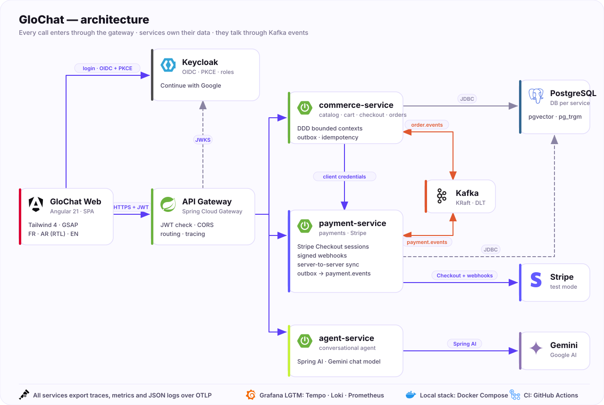

| Service | Port | Responsibility |
|---|---|---|
| **api-gateway** | `8080` | Single entry point: JWT validation, CORS, routing to the services, trace propagation |
| **commerce-service** | `8081` | Bounded contexts **catalog**, **cart**, **checkout**, **orders** (+ outbox to Kafka) |
| **payment-service** | `8084` | Stripe Checkout sessions, webhooks, payment status, outbox to Kafka |
| **agent-service** | `8085` | Conversational agent (Spring AI + Gemini) |
| **Keycloak** | `8180` | Identity: customers, Google brokering, service clients |
| **Grafana LGTM** | `3001` | Traces, logs and metrics |

### Inside commerce-service — DDD, enforced by tests

```
commerce/
├── catalog/    domain · application · infrastructure (search, merchants, products, pricing)
├── cart/       domain · application · infrastructure (cart, addresses)
├── checkout/   domain · application · infrastructure (quotes, confirmation)
├── orders/     domain · application · infrastructure (state machine, outbox, payment events)
└── shared/     business errors → RFC 7807, transactions port, security, observability
```

- The **domain** is plain Java (no Spring); use cases depend on **ports**, adapters live in `infrastructure`.
- Bounded contexts talk to each other only through their `application` API.
- These rules are checked on every build by **ArchUnit** (`ArchitectureTest`).

---

## 🔁 Key flows

### Checkout and card payment

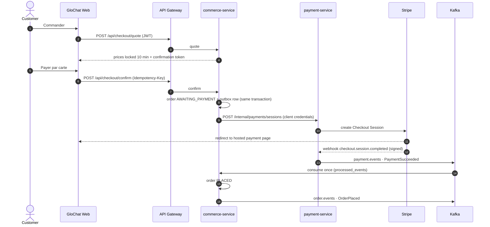

### Order lifecycle

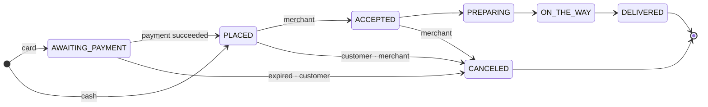

### API (through the gateway)

| Method | Path | |
|---|---|---|
| `POST` | `/api/catalog/search` | Search dishes across restaurants for a location |
| `GET` | `/api/catalog/merchants` · `/merchants/{id}` | Restaurants with delivery terms · merchant page |
| `GET` | `/api/catalog/products/{id}` | Product detail with option groups |
| `GET` `POST` | `/api/cart` · `/api/cart/operations` | Read the cart · add / update / remove lines |
| `PUT` | `/api/cart/delivery` · `/api/cart/payment-method` | Address and payment method |
| `POST` | `/api/checkout/quote` · `/api/checkout/confirm` | Price-locked quote · idempotent confirmation |
| `GET` `POST` | `/api/orders` · `/{number}` · `/{number}/cancel` · `/{number}/pay` | History, detail, cancel, pay again |
| `POST` | `/api/payments/stripe/webhook` | Stripe webhook (signature verified) |

Errors follow **RFC 7807** (`application/problem+json`) with a stable `code`, e.g. `CART_MERCHANT_CONFLICT`, `PRICE_CHANGED`, `QUOTE_EXPIRED`.

---

## 🧰 Tech stack

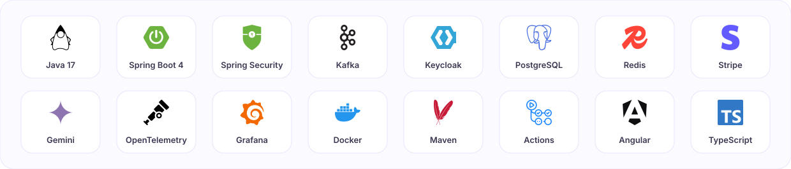

| Layer | Choices |
|---|---|
| Backend | Java 17 · Spring Boot 4 · Spring Cloud Gateway · Spring Security (resource server) · Spring AI · JDBC + Flyway |
| Messaging | Apache Kafka 4 (KRaft) · transactional outbox · idempotent consumers · DLT |
| Data | PostgreSQL 17 (pgvector, pg_trgm) — one database and one role per service · Redis (provisioned in the stack, not used by the services yet) |
| Identity | Keycloak 26 · OIDC + PKCE · Google identity brokering · client credentials between services |
| Payments | Stripe Checkout (`stripe-java`) · signed webhooks |
| Observability | OpenTelemetry (OTLP) · Micrometer · Grafana LGTM (Tempo, Loki, Prometheus) · ECS JSON logs |
| Quality | JUnit 5 · Testcontainers · ArchUnit · gitleaks · GitHub Actions |
| Web client | Angular 21 · Tailwind 4 · GSAP · Vitest · Playwright |

---

## 🚀 Run it locally

**Prerequisites:** JDK 17, Docker, Python 3 (test scripts).

```bash
# 1. Configuration: random dev passwords + local URLs in infra/.env (git-ignored)
bash infra/generate-dev-env.sh

# 2. Infrastructure: PostgreSQL, Kafka, Redis, Keycloak, Grafana
docker compose -f infra/docker-compose.yml --env-file infra/.env up -d

# 3. Build and start the services (each one reads infra/.env)
./mvnw package -DskipTests
bash infra/run-service.sh api-gateway
bash infra/run-service.sh commerce-service   # demo restaurants in Rabat (Spring profile "demo")
bash infra/run-service.sh payment-service
bash infra/run-service.sh agent-service
```

Optional:
- **Stripe** — put your test keys (`STRIPE_SECRET_KEY`, `STRIPE_WEBHOOK_SECRET`) in `infra/.env`.
- **Continue with Google** — set `GOOGLE_CLIENT_ID` / `GOOGLE_CLIENT_SECRET`, then `bash infra/keycloak/configure-google.sh`.
- **Gemini** — set `GEMINI_API_KEY`.

### ⚙️ Configuration

Nothing environment-specific is hard-coded: every URL and secret comes from environment variables, and a service
**refuses to start** when one is missing (no silent fallback to `localhost`). All variables are documented in
[`infra/.env.example`](infra/.env.example):

| Variable | Used by |
|---|---|
| `WEB_BASE_URL`, `CORS_ALLOWED_ORIGINS` | Stripe return URLs, gateway CORS, Keycloak redirect URIs |
| `KEYCLOAK_PUBLIC_URL`, `KEYCLOAK_ISSUER_URI`, `KEYCLOAK_JWK_SET_URI`, `KEYCLOAK_TOKEN_URI` | Token validation, service-to-service tokens |
| `COMMERCE_URL`, `PAYMENT_URL`, `AGENT_URL` | Gateway routes, commerce → payment |
| `COMMERCE_DB_URL`, `PAYMENT_DB_URL`, `KAFKA_BOOTSTRAP_SERVERS` | Data and messaging |
| `OTEL_EXPORTER_OTLP_ENDPOINT` | Telemetry export |
| `*_PASSWORD`, `*_SECRET`, `STRIPE_*`, `GEMINI_API_KEY`, `GOOGLE_*` | Secrets — only in `infra/.env` or your secret manager |

---

## 🧪 Tests

```bash
./mvnw verify                    # unit + integration (Testcontainers) + ArchUnit, all services
bash infra/smoke-test.sh         # the local stack is up and correctly configured
bash infra/e2e-security.sh       # real Keycloak tokens through the real gateway
bash infra/e2e-observability.sh  # one request = one trace in Tempo, its logs in Loki
python infra/e2e-checkout.py     # cart → checkout → order → Stripe test mode on the running stack
```

| Module | Tests |
|---|---|
| commerce-service | 97 — domain rules, API integration (PostgreSQL), Kafka events, security, architecture |
| payment-service | 18 — Stripe sessions and webhooks, idempotency, amount checks, architecture |
| api-gateway | 9 — routing, JWT, CORS |
| agent-service | 7 — security, production-like context with Gemini and OTLP exporters |
| marketchat-common | 9 — money, token validation |

CI (GitHub Actions) runs a **gitleaks** secret scan, the full Maven build with tests, then the end-to-end scripts against a real Docker stack.

---

## 🌿 Branching

Git flow — `main` only receives releases (tagged), `develop` integrates features.

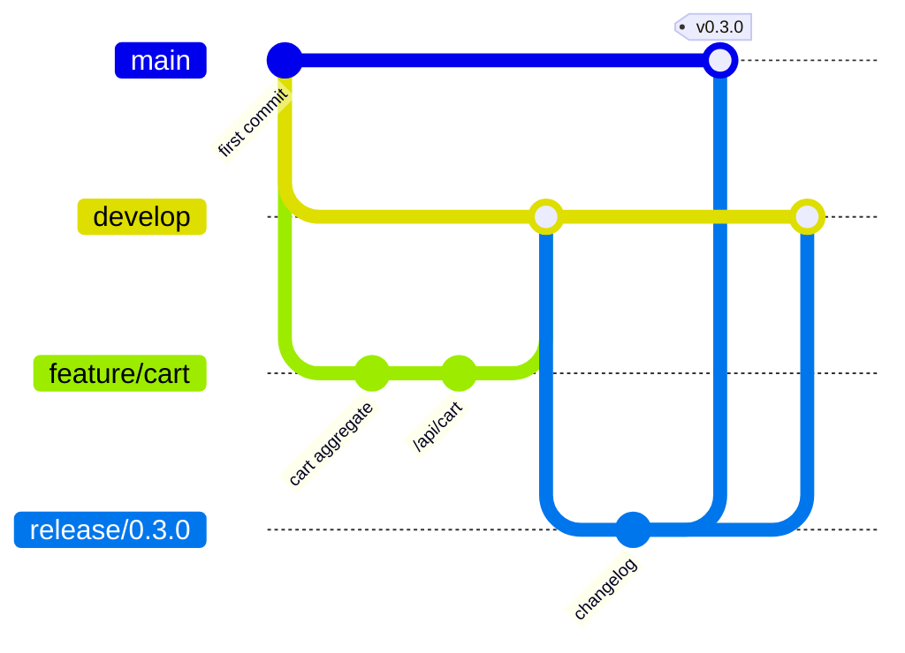

Releases are listed in [CHANGELOG.md](CHANGELOG.md).

---

## 🗺 Roadmap

- [x] Catalog, search, merchant pages
- [x] Cart, price-locked checkout, orders, Stripe payments
- [x] Keycloak + Google sign-in, observability, CI
- [ ] Live order tracking (SSE) and a merchant simulator
- [ ] MCP tools exposing the catalog and the cart to the agent
- [ ] Conversational ordering agent with Gemini

---

<div align="center">

<br/>
<sub>Built by <a href="https://github.com/ISTIFANO">ISTIFANO</a> · photos credited in <code>services/commerce-service/src/main/resources/media/CREDITS.md</code></sub>
</div>
